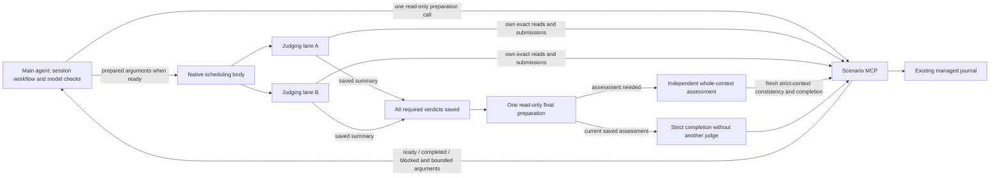

# Native Specification Review Implementation Plan

Status: Technically agreed; parent waiting, followup and final-stage optimizations included; implementation not started

## Revision boundary

The user authorizes planning, not implementation. The agreed direction keeps one
read-only MCP preparation scenario, actual main-agent host/model checks, independent
judges that read originals and submit their own verdicts, and acknowledgments only
after saving. No inspector/writer agent, agent-side write-turn queue or per-group
all-workers barrier is introduced.

The explicit full/followup correction cycle remains. This revision adds the three
accepted final-stage optimizations: one-call MCP preparation, programmatic exact
pagination in the same judging actor where supported, and completion from a fresh
saved consistency assessment without another final judge. All six revised exact
technical checks are ready against the unchanged Approved specification.

K=20 workload units, at most four concurrent detailed judges, weighted groups,
no total-item/global outstanding cap and review-lifetime exact replay are unchanged.
Earlier superseded 2/20/160 limits are not restored. The four required Harness live
reviews remain unchanged; this revision adds no billable trial or model matrix.

The current parent-waiting revision explicitly hands control to the native workflow
without status-polling model turns. Pinned Harness holds the parent call until the
terminal result. P01/P02/P03/P04/P05 have updated exact bindings; P00 and the previous
shared, followup and final-stage commitments retain their bytes.

## Approved inputs

- Specification: `docs/specs/specification-review-native-workflow/spec.md`.
- Confirmed depth: Standard; profiles: core, cross-surface, operations.
- Current `source_version`: `73f93f290e0ee7f969abc43af3121ea341dbe82a1db897896c27c678d09e7f43`.
- Current `specification_version`: `969d6857c4f6decb623d7b60d841223057289f9dc0fb94f85fa4291f573ade2f`.
- Current `review_ref`: `442a54a2-2c8a-4cf0-b3eb-44e9e77edb05`.
- MCP reports the revised specification Approved/reviewed with its approval
  checkpoint; independent full review saved all details and final consistency.
- The confirmed manifest lists no additional profile or design artifacts. Keep
  architecture and verification maps in this bundle; no second contract ledger.
- No product-task binding exists. No product or design workflow is required.
- All six packets have current technical agreements. This agreement does not
  authorize implementation, generation, live trials, installation, commits or
  publication; each execution retains its separate scope and dependencies.

## Shared technical commitments

Every selected packet proposal binds this exact section. Private helper names
are illustrative; the named public boundaries and algorithms below are binding.

1. Keep one portable native body and literal metadata under
   `skills/spec-driven-development/workflows/`, assembled by the existing strict
   generator. The body is a host program using only supported `agent`, `parallel`,
   `phase`, `log` and `args`; no assumed direct MCP, imports, filesystem, network,
   clocks or random APIs. Agents make scenario calls. Add no generic registry,
   dispatcher, installer, provider manager, dependency or background service.
2. The main agent performs actual session-native/schema/permission/model checks
   and one initial read-only MCP preparation call. Preparation resolves exact
   target/source/review, confirmed scope, current progress and server prerequisites,
   returning ready-to-run arguments, completed outcome or blocked with reasons.
   No prerequisite open/status chain or inspection child. A caller-observed host
   concurrency budget is input, not server-certified host capability. Blocked or
   completed preparations do not dispatch; missing host support still blocks a
   server-ready launch. Repeat preparation/host checks on every new invocation.
3. Preparation computes N pending items, L_i exact required Unicode text lengths,
   w_i = max(1, ceil(L_i / 4096)), W = sum(w_i), K = 20 and
   R = min(4, permitted host concurrency, N, ceil(W / K)); N = 0 dispatches no
   detailed judge. Weights include complete original/question/answer/amendment
   and linked requirement text, not source previews or model guesses. These are
   workload estimates, not semantic difficulty, token quotas or latency promises.
4. Form groups from ascending pending items: maximal next-item prefix with sum
   of weights <= K, at most 20 items. An item heavier than K stands alone and is
   never split between judges or summarized to fit. Greedily assign each group
   to the lane with least total assigned estimated weight; ties use lane index.
   Freeze this allocation against the initial saved-progress observation and
   unchanged review inventory; completion timing cannot alter group ownership.
   Never dispatch an empty lane. No separate global outstanding-item cap and no
   per-invocation item/child-count cap are introduced. Respect actual native limits.
5. Keep launch arguments/continuations bounded, not all pending items in script
   memory. Use server-issued stateless plan/lane cursors derived from the review,
   source/inventory identity, policy, R/K and the initial saved-result prefix
   count/digest. Existing recorders append results (`src/reviews.ts:280`, `:294`);
   later appends do not change that prefix. Derive groups from items unfinished
   at that checkpoint, then skip currently saved items without reallocating lanes.
   A changed/missing prefix or source invalidates the cursor. This requires no
   durable plan table, reservation, queue, process-local cursor cache or new ledger.
   A judging child fetches its bounded group metadata through preparation
   continuation, reads/judges/submits, and returns saved summary + next cursor.
   The body starts a fresh judging child for the next group after its own lane's
   saves; it holds only active cursors/summaries. Paginated metadata is not exact
   source consumption and never grants a read receipt.
6. Each judge consumes all assigned originals/continuations and applicable
   reviewer/profile guidance, forms its own semantic verdict and submits it
   directly. No separate writer, unsaved-verdict handoff or worker context relay.
   A slow lane does not block another group's dispatch. On failure stop new work,
   account for launched operations and reconcile saved/unknown effects. Findings
   alone do not stop valid remaining checks. Only final assessment joins all saves.
7. MCP owns scope, identities, immutable inputs, receipts, saved verdicts and
   completion. P00 adds preparation/continuation and narrow direct submission.
   Existing strict-context tools retain stale/conflict behavior. Submission checks
   unchanged source/review and exact evidence under a cross-process mutation
   boundary, prevents overwrite and saves a whole batch atomically. Bounded lock
   waiting/backpressure defaults to a 5-second acquisition deadline; cancellation
   stops uncommitted waiting, while already committed effects remain saved/unknown
   on lost response. Never auto-remove crash locks or promise cancellation rollback.
8. Acknowledge only saved batches, not enqueue. Identical logical batch replay
   is safe for the retained review's entire lifetime, including restart, response
   loss, generic receipt-window pressure and already completed reviews. Bind replay
   to exact content/review independently of incidental physical context. Validate
   saved replay before rejecting a completed review's new writes. Different content
   conflicts without overwrite. Persist necessary replay evidence atomically with
   results in the current journal. No async inbox, short-window-only guarantee or
   general weakening of stale checks. Preserve archived body/receipt/continuation
   identities; do not sort/reformat old inputs or result prefixes for this feature.
9. Use the read-only final-stage selection and exact branches in
   `Final-stage efficiency and recovery`. If a new assessment is needed, one
   separate final judge consumes the whole required input, records consistency
   and requests strict completion. Same-actor programmatic pagination requires
   real host support and budgets. A current saved assessment takes completion-only
   recovery without a new judge. Actual MCP state decides reviewed/gaps; the author
   separately checks freshness before Approved. The runner never enrolls or approves.
10. New/recovery invocations prepare afresh, preserve saved results and use exact
    replay/status to resolve uncertain effects. Claude cached `resumeFromRunId`
    is not fresh evidence; pinned Harness has no script restart journal. Exhausting
    actual host limits leaves incomplete with progress; inventory size alone never
    terminates work at an invented 160-item boundary. No cross-actor source cache.
11. Discover callable logical tools/schemas at runtime, including preparation and
    submission. Missing new capability blocks dependent native work. Preserve the
    ordinary independent/sequential and Codex paths. Native entry remains explicit;
    promotion as an efficiency default needs measured evidence and separate agreement.
    Harness parent discovers actual routes and obtains real user pairs for judging/
    final roles before dispatch; no inspection-model role. Reuse choices only for
    the same task/role while available. Use no undocumented native options.
12. Retain 1–20 submission items, 131,072 UTF-8 argument bytes, 24 KiB structured
    results, 64 KiB complete tool results and exact portions <=4,096 code points.
    Judges may split their own group submission, retaining every saved acknowledgment.
    No dropped nulls, truncation, fabricated receipts or summaries replacing exact
    evidence. Preparation stays read-only, including after Draft-to-Approved edits;
    server readiness is not approval, semantic proof or an authenticated host claim.
13. Qualification uses isolated projects, clients and MCP processes; never target
    `testing-and-verification` or refresh shared runtime. Actual clients, routes,
    authentication/provisioning, billable trials and independent document reading
    retain manual gates. Count every actor, preparation/metadata call, payload,
    lock wait, time and exposed tokens. Model price/Node fixtures do not prove savings.
14. Apply root JS/TS development/readability/lifecycle rules to repository code,
    not distributed prompts/templates. Preserve unrelated and overlapping generator/
    model-route work; inspect disposition before execution. No bulk refactoring.

## Final-stage efficiency and recovery

This realizes approved NWF-005/008/009/010/011/012/014/015 without changing
semantic review obligations or the author's approval authority.

1. Extend the already planned `specification_review_prepare_workflow` scenario
   with a final-stage selection. One read-only call coherently checks the exact
   target, source/review, required-result set, saved detailed outcomes and existing
   consistency evidence. Preserve top-level `ready_to_run`, `completed` and
   `blocked` outcomes; ready arguments distinguish detailed work, a fresh final
   assessment and completion only. Missing required saves, stale identities or
   inconsistent observations produce concrete blockers. Negative detailed verdicts
   remain final-assessment inputs, not a reason to skip that assessment.
2. Return bounded references/continuations and fresh context, not originals,
   complete verdict dumps or receipts for undelivered text. Final preparation
   replaces an external open/status/readiness chain used only to assemble inputs.
   It does not enroll, reserve, record consistency, complete review, observe approval
   or certify host capabilities. Later operations retain their own freshness checks.
3. When an assessment is required, one independent final judge consumes the whole
   current specification and mode-required exact saved outcomes, records its own
   consistency verdict and requests strict completion. Where its actual environment
   supports tool composition, follow the cursor chain programmatically in that same
   actor: retain every original portion, ordering, identity and terminal receipt
   within real execution, context and result budgets. A separate model turn merely
   to advance each cursor is unnecessary. Otherwise use ordinary exact cursor reads
   and report the limitation. This grants no direct MCP API to the workflow VM,
   cross-actor text cache, truncation or summary substitution.
4. After interruption, initial preparation may establish that all required detailed
   results and a current consistency verdict are saved and only completion remains.
   Revalidate that persisted verdict against the owning review/source and current
   required-set/detailed-result identity. Launch no new final judge, reread no source
   for a repeated judgment and overwrite no verdict. The existing main actor calls
   `specification_review_complete` with fresh strict context, using verified host
   tool composition where supported or its ordinary scenario call otherwise.
   Completion is a separate mutation; preparation remains read-only. A valid saved
   negative consistency verdict completes as gaps, never pass.
5. A completed review returns its actual saved outcome without dispatch. After a
   lost completion reply, inspect fresh owning state before retrying; local script/
   child success is not MCP completion. New inputs, mandatory-set expansion, changed
   detailed outcomes or missing/stale/unestablished consistency evidence forbid
   completion-only reuse. Preserve valid detailed results, resolve pending work and
   obtain the required fresh whole-context assessment. Lost unsaved actor context
   requires exact redelivery; summaries and foreign receipts cannot replace it.

P00 owns read-only final selection and authoritative checks; P01 owns conditional
dispatch and same-actor pagination; P02 owns entry/recovery guidance; P03 owns real
MCP controls; P04 measures this path within the existing four Harness reviews; P05
explains it. No extra inspector, service, queue, cache or live review is introduced.

Required controls cover one-call/read-only final preparation, incomplete/stale
inputs, a real cross-section finding, Unicode/escaped exact reconstruction and
terminal receipts, interruption before consistency saving versus after saving,
restart/lost-completion recovery, negative consistency, and source/required-set/
result invalidation. Only a fresh saved assessment permits zero new judging
children. Apply PROVE to premature final dispatch, dropped portions/receipts,
forced rejudging of fresh saved evidence, stale reuse and completion inside
preparation. Measure calls, bytes, turns and exposed tokens; simulations or fewer
parent turns alone do not establish savings.

## Corrections and repeat-review scenario

This realizes existing contracts, not a new review protocol: approved
`docs/specs/specification-completeness/spec.md`, REV-002/REV-003/REV-004 and
VAL-003; this specification's NWF-001/004/008/009/013/014/015; and the canonical
`skills/spec-driven-development/references/followup-review.md`, sections
`Author: Prepare One Correction Set` and
`Independent Checker: Detail Plus Whole-Specification Consistency`.
Use existing scenarios and their actual schemas; preserve their eligibility,
receipts, inherited provenance, strict-context mutation and completion semantics.
No new behavioral source, profile, total-item cap or live-trial workload is added.

The outer loop belongs to the authorized specification author/main agent. The
native script remains one independent review pass: it never edits requirements,
chooses new product behavior, enrolls another review or approves its own input.
An explicitly review-only request returns findings without silently authorizing
specification edits. When authoring/correction is already authorized, use this
sequence without asking to proceed after every source-supported repair:

1. Enroll the appropriate full review, prepare it once and run independent native
   judging lanes followed by final consistency. Finish collecting valid findings
   rather than stop on the first semantic gap. Return actual MCP completion or
   incomplete/stale/cancelled/failed state and acknowledged progress to the parent.
2. `reviewed` returns control for the author's ordinary freshness/Approved step.
   `gaps` returns exact finding references/counterexamples. An authorized Draft
   authoring cycle stays Draft; review-only invocation leaves document status intact.
   Gather a source-supported correction set; ask the user only for genuinely new
   material decisions. Never label an unchanged or guessed repair as progress.
3. After corrections, the author calls `specification_review_changes_summary`,
   consumes every navigation continuation, then uses its exact `report_version`
   with `specification_review_changes_read` through terminal `changes_receipt`.
   Map every change to returned finding keys with fixes/explanations. If eligible,
   call `specification_review_followup_start`. This is an author claim requiring
   independent recheck, not semantic proof or consent authentication.
4. Reuse the same native body for that server-enrolled followup. Preparation reads
   mode, mandatory/pending sets, carried provenance and actual progress from MCP;
   never accept an author-selected subset or treat a carried result as a new check.
   Compute N/W/R and groups from current pending work only. Positive unaffected
   evidence stays provisionally carried under REV-003; missing/failed/affected
   items stay pending. Each judging actor freshly consumes and saves its own
   assigned mandatory evidence. No duplicate check of every carried source.
5. When a fresh final assessment is required, full and followup final payloads
   are not assumed identical. Full mode already
   exposes detailed results in enhanced context. Followup final assessment consumes
   the exact whole-specification/scope/previous-findings context required by REV-003
   and current mandatory detailed outcomes. Preparation provides a bounded cursor
   over the followup's current required detailed item references/provenance,
   independent of pending-only allocation, so already-saved mandatory results remain
   discoverable after restart/expansion. It returns no verdict bodies or receipts.
   The final actor uses existing `specification_review_get` through complete for
   those references to inspect exact `recorded_result`, then reads the latest whole
   context and records consistency/completion. Do not individually reread every
   unaffected inherited source merely to reconstruct all results. Preserve existing
   `reviewBody`/`materialize` serialization and receipt compatibility. Current saved
   consistency may use completion-only recovery above; changed required sets or
   outcomes still require the fresh-assessment path.
6. A checker may identify cross-impact on an inherited item during an unfinished
   followup. It returns a bounded request containing exact item keys and reason;
   the native pass stops new dispatch and quiesces/accounts for launched work.
   The parent forwards that unchanged request through existing strict-context
   `specification_review_scope_expand` using fresh context. No separate verdict
   writer is introduced. An already-quiescent final actor may apply expansion
   directly. Expansion withdraws only the relevant inherited evidence and any
   prior context/consistency verdict; it cannot erase fresh detailed results or
   remove mandatory work. If a fresh result is disputed, report a concrete finding
   instead of overwriting it. Completed reviews cannot be expanded.
7. Expansion changes the required set and can invalidate the saved-result prefix.
   Stop using old assignment/reference cursors and final receipts. Report the pass
   incomplete with the actual expansion/recovery action, prepare afresh for the
   same unfinished followup and run the remaining work. Keep valid saved results;
   recalculate workload only from remaining mandatory items. Final assessment reads
   the whole latest context again after new saves. Do not start a full review
   solely because the allocation cursor expired or a dependency set expanded.
8. A completed followup with remaining findings may receive another source-supported
   correction set and followup from the latest completed findings review. Resume
   unchanged interrupted work without reenrollment; reconcile unknown write effects
   first. Never blindly rerun an unchanged gaps result or invent fixes/retry success.
   Missing authorization, user decision, exact evidence or host capability leaves
   an explicit next action and owner, rather than an endless automatic loop.
9. Use full review when REV-003/MCP disallows inheritance: new instructions/answers,
   changed scope/profiles/source meaning, removed items, Approved specification,
   unavailable legacy snapshots or impact that cannot be bounded. Report the
   concrete reason; do not force followup or silently transfer verdicts. An archive
   storage fault may block review altogether and requires explicit investigation.
   No raw managed-file/archive access or manual repair is an alternative.

Required protocol/scheduling fixtures (simulation-only semantic answers):

| Scenario | Required observation |
| --- | --- |
| Full findings -> repair -> followup | Real summary/read/fix links choose the mandatory dependency closure; only pending items are detailed-read by judges; carried items retain original provenance |
| Final evidence without broad reread | Required-result reference pagination includes saved mandatory items, excludes unrelated carried sources, respects byte budgets and exposes no verdict bodies; final reads exact current results and whole context |
| Cross-impact expansion | Previously carried C is withdrawn after all active work is accounted for; old allocation/final receipts cannot complete; fresh preparation of the same review schedules C and preserves valid saves |
| Interrupted/second correction cycle | No duplicate enrollment/write, no lost finding and no fabricated freshness; exact status/replay distinguishes saved/unknown; latest completed findings review is the next parent |
| Ineligible reuse/review-only scope | Correct full-review/blocker path for new decisions, Approved/removed/corrupt evidence or unbounded impact; review-only invocation never edits spec |

Observe actual scenario calls, item keys, carried_from, review/source identity,
receipts and current result counts; never fake archives or infer semantic safety
from hashes. PROVE must detect dispatching all carried items, accepting a stale
post-expansion cursor/receipt, skipping mandatory work, removing fresh results,
editing spec inside native code or bypassing final whole-context assessment.
P03 owns real-MCP fixtures and P01/P02 their policy/entry wiring checks. P00 owns
bounded mode-aware metadata and current required-reference continuation, reusing
existing followup state rather than a new persistence layer. P05 documents these
paths. Keep P04's existing four Harness live reviews unchanged; deterministic
followup fixtures do not claim additional live model qualification.

## Packet index

| Stage / packet | Reviewable unit | Dependencies / gate | Technical state |
| --- | --- | --- | --- |
| S0 | Revised behavior, independent specification review and approval | Confirmed scope and actual adaptive/replay decisions | Complete; Approved/reviewed |
| [P00](00_mcp_submission.md) | One-call MCP launch preparation and cross-process saved batch submission | S0; new technical agreement; separate execution authority | ready; followup binding in packet |
| [P01](01_portable_orchestration.md) | Direct-submitting judges and independent worker lanes | P00 complete; new agreement and execution authority | ready; followup binding in packet |
| [P02](02_host_generation.md) | Matching native artifacts and capability-aware explicit entry | P01 complete; overlap disposition; new agreement | ready; followup binding in packet |
| [P03](03_protocol_qualification.md) | Actual multi-process MCP and workflow qualification | P00/P01/P02 complete; new agreement | ready; followup binding in packet |
| [P04](04_native_host_trials.md) | Harness runtime/model trials and measurements | P03 complete; new agreement; explicit trial authority and hosts/routes | ready; exact binding in packet |
| [P05](05_developer_documentation.md) | Qualified developer/operator guide | P04 required evidence; new agreement; independent document reader | ready; followup binding in packet |

Agreement, dependency completion and execution authority are separate. This
revision changes all shared proposal sources. Preserve earlier managed records;
none grants readiness to the new design. Prepare replacement proposal bindings
only against the revised Approved specification after S0.

## Workflow ownership and parent waiting

After a successful native launch, the main agent hands control to the workflow and
does not spend model turns polling status. The workflow owns worker scheduling,
joins, result collection and its declared recovery branches. Progress uses native
observer events; it does not require parent-model status calls or a polling agent.

The verified Harness baseline is 0.2.1-rc.3 at commit
`22ddee3792402c3e70ec5f86a63c3e3e895a2f60`. Its parent `workflow` tool call
waits for the whole run and returns one terminal result. The main agent remains
suspended in that call until completion, failure or cancellation, then handles the
actual outcome. Do not end/dispose the owning session while the run is pending,
invent background start/poll/wakeup tools, or simulate waiting through model turns,
status loops or repeated sleep calls. This is foreground waiting, not a detached
run that later wakes a finished parent turn. The pinned
[workflow contract](https://github.com/deepseek-ai/deepseek-harness/blob/22ddee3792402c3e70ec5f86a63c3e3e895a2f60/packages/workflow/workflow/README.md)
owns this behavior; use only verified native wait semantics on other hosts.

After the terminal result, the main agent may perform the required owning MCP
completion or recovery checks, including completion-only recovery from current
saved consistency. Those integrity checks and the judges' exact reads/submissions
remain required; the prohibition is parent status polling while the run is pending.
Preserve host cancellation and owned-child cleanup; waiting never claims rollback.

P01/P02 own orchestration/entry, P03 owns controlled entry/protocol traces, P04
observes the actual Harness path within its existing four live reviews, and P05
documents it. Controls must observe one launch, zero parent-generated polling
calls or extra coordination turns while pending, and resumption on the terminal
outcome. Test the project-owned entry/runner boundary, not JavaScript await itself;
a mutation that adds parent polling must fail the control. Preserve cancellation
and cleanup controls. Simulated traces do not establish real native/model behavior.

## Architecture and ownership

| Unit | Ownership and direction | Lifecycle / material invariant |
| --- | --- | --- |
| `state.ts::mutate` | Existing generic strict-context mutation, `packages/engineer-agent-workflow-mcp/src/state.ts:377` | Exclusive lock currently returns BUSY on contention; physical-ledger context conflicts remain for existing callers |
| New preparation scenario (logical name candidate `specification_review_prepare_workflow`) | P00: launch/final selection -> weighted lanes or assessment/completion-only arguments | Coherent bounded read-only observation; no verdict, reservation, completion, approval write or host certification |
| New submission scenario (logical name candidate `specification_review_submit_batch`) | P00: validate independent judge input -> guarded current review mutation | Cross-process bounded acquisition, unchanged source/review, atomic persistence and saved ACK; name/schema await S0 |
| Existing followup impact/start/expand | `src/review-followup.ts:39`, `:302`, `:325`, `:339` | MCP selects mandatory/candidate closure, preserves provenance and invalidates inherited/final evidence on expansion |
| Existing receipt/input model | `src/review-model.ts:20`, `:85`; `src/review-followup.ts:205` in the MCP package | Preserve archived text, receipt identities and continuation compatibility |
| `validateVerdict`, record batch, completion | `src/reviews.ts:151`, `:283`, `:306` | Reuse validation; existing tools do not silently acquire new stale/retry semantics |
| Registration | `src/server.ts:31`, `:103` | Publish preparation/submission scenarios and bounds through existing schemas/runtime ownership |
| Main-agent preflight | P02 entry: one preparation call + actual session capability/route checks -> prepared arguments | Existing main context; no child launch; no server claim about host tools/models; operation-time freshness checks remain |
| Canonical body / metadata | P01: validate prepared inputs -> independent lane progress -> judging agents -> MCP | Only active cursors/summaries; no durable cache, inspection child, writer role or total-item cap |
| `collectReleaseSource`, `renderHostTemplate`, `buildGeneratedFiles` | P02; `scripts/lib/distribution.mjs:311`, `:257`, `:563` | Existing strict rendering, per-host Maps and atomic output replacement |
| Final judging actor | P01/P03/P04 | Fresh full source and all saved results after JOIN; separate from detailed judges/author |
| `createSharedStdioHarness` | P03; `packages/engineer-agent-workflow-mcp/test-support/stdio-harness.mjs:14` | Actual isolated clients/processes, deterministic test coordination and cleanup |
| Opt-in qualification runner | P04; existing pattern `scripts/qualify-product-workflows.mjs:75` | Explicit client/workspace/routes, no import effect, cleanup and redacted evidence |

Paths abbreviated `src/` above belong to `packages/engineer-agent-workflow-mcp/`.
Reverify symbols/line offsets before execution; unrelated work may move them.
The existing generic retry receipt window is only 64 records and its identity
includes context. That is evidence for specifying review-scoped submission retry
semantics, not proof that generic receipts already meet the new contract. An
in-process promise queue alone cannot protect distinct MCP server processes.

## Requirement and verification coverage

IDs refer to the revised Approved specification, including NWF-015. This map
is implementation coverage, not a substitute for the saved independent S0 review.

| Requirement | Draft owners | Discriminating observation |
| --- | --- | --- |
| NWF-001 | P00/P01/P02/P03 | One MCP preparation returns exact target, current progress and bounded arguments or blocker; stale/foreign inputs cannot save unrelated results |
| NWF-002 | P00/P02/P04 | MCP checks server prerequisites; main agent checks actual native schemas/routes; server readiness alone never launches an unavailable host |
| NWF-003 | P01/P02/P03/P04/P05 | Native-owned scheduling and collection; parent awaits one terminal result without polling turns; actual MCP outcome decides completion |
| NWF-004 | P00/P01/P03/P04 | Missing/duplicate/foreign assignment and omitted retained-ID clause do not pass |
| NWF-005 | P00/P01/P03/P04 | Each judge consumes its own exact originals/continuations and submits its own findings |
| NWF-006 | P00/P01/P03/P04 | Formula selects 1–4 judges and weighted groups; unequal sizes, host caps and >160 items retain complete independent progress |
| NWF-007 | S0, P00/P01/P03 | Concurrent direct submissions across processes persist without overwrite or context relay; ACK follows save |
| NWF-008 | P00/P01/P03/P04 | One final preparation; full exact judgment when needed; fresh saved judgment permits completion only; expansion invalidates earlier evidence |
| NWF-009 | P00/P01/P02/P03/P04/P05 | Same-body full/followup runs, scoped correction cycles, expansion/reprepare and full fallback preserve saved progress |
| NWF-010 | P00/P01/P02/P03/P04 | Real wire/argument bounds and exact reconstruction; same-actor programmatic delivery is capability- and budget-bound |
| NWF-011 | P00/P01/P03/P04 | Preparation is read-only and bounded; existing journal only; no job inbox, managed-file bypass, cross-target state or source/token dumps |
| NWF-012 | P04 | Paired frozen inputs and actual models; every actor, server wait, time/tokens and missing metric counted |
| NWF-013 | P00/P02/P03/P04 | One body, correct target formats, strict-tool compatibility, unchanged Codex/sequential paths |
| NWF-014 | P00/P01/P02/P03/P04/P05 | RED/GREEN/PROVE protocol controls, actual native semantic evidence and documented acceptance stay distinct |
| NWF-015 | P00/P01/P02/P03/P04/P05 | One read-only launch call, weighted bounded lane continuations, no reservation/approval side effect or host-certification claim |

## Supported environments and evidence gaps

- Root/MCP manifests require Node >=22.20.0. Existing dependencies and test runners
  suffice for the proposed deterministic tests; no installation is authorized.
- Previously checked Claude CLI reported 2.1.293. A version is not proof of a
  callable Workflow tool. P04 must inspect the actual native schema and runtime.
- Harness baseline: 0.2.1-rc.3, upstream commit
  `22ddee3792402c3e70ec5f86a63c3e3e895a2f60`. `dsh` was absent from PATH at
  inspection. Preparing a client/routes is a separate manual gate.
- Planning MCP scenarios are callable. P00's proposed preparation and submission
  scenarios do not exist yet; no native host/model qualification is established.
- No new external API assertion is introduced by this draft. Recheck the actual
  installed host schemas and pinned sources before P02/P04 execution:
  [Claude workflows](https://code.claude.com/docs/en/workflows),
  [Claude invocation types](https://code.claude.com/docs/en/agent-sdk/typescript),
  [pinned Harness workflow](https://github.com/deepseek-ai/deepseek-harness/blob/22ddee3792402c3e70ec5f86a63c3e3e895a2f60/packages/workflow/workflow/README.md),
  [pinned Harness PTC](https://github.com/deepseek-ai/deepseek-harness/blob/22ddee3792402c3e70ec5f86a63c3e3e895a2f60/packages/workflow/workflow-ptc/README.md).

## Rollout, recovery and manual gates

1. S0 revises the behavioral specification. Planning then reconciles this draft
   with the new source identities and obtains each exact technical agreement.
2. Execute one separately authorized packet at a time, P00 through P05. Inspect
   tracked, staged and untracked overlap; a clean tree/commit is not required.
3. P00 qualifies read-only preparation and the persistence boundary before P01
   uses them. Preserve existing
   strict-context callers and reader compatibility; never refresh a shared MCP
   process as a side effect of building or testing disk artifacts.
4. P01/P02 deterministic checks precede P03 actual-MCP integration and P04 real
   engines/models. Each behavior packet starts with discriminating checks and
   relevant RED; correct implementation until correct checks pass. Apply PROVE
   where required by the test discipline and restore every mutation.
5. **MANUAL GATE — P04:** explicit trial authority, compatible isolated clients,
   authentication and actual permitted routes. Provisioning owner is not yet
   established. Missing required evidence keeps the packet incomplete.
6. **MANUAL GATE — P05:** an independent document reader and applicable actual
   delegation/model consent. This is document acceptance, not a code-review gate.
7. **MANUAL GATE — lifecycle/publication:** installation, enablement, shared MCP
   refresh/reconnect, commits and publication require separate explicit scope.
8. On failure stop new dispatch, preserve saved batches and report known/unknown
   effects. Use fresh MCP state and the specified retry path. Cancellation does
   not undo durable work. Roll back only known packet files or existing atomic
   generation output; never restore unrelated work or delete managed history.

## Documentation decision

P05 is warranted because the feature crosses native hooks, judging contexts and
multi-process MCP persistence. Direct submission, saved acknowledgments, bounded
waiting, lost-response recovery and the final JOIN need one durable operator
guide. Existing installation/provider documents remain authoritative; root
repository development rules do not become distributed skill content.

## Planning verification

The Approved specification, behavioral identities and scope remain unchanged.
The parent-waiting revision adds one shared section, bound by P01/P02/P03/P04/P05.
P00 and the previously frozen shared, correction and final-stage sections are
unchanged. All six exact technical checks are ready. Prior managed answers remain
immutable; the current direct user instruction is recorded without inventing a
native-question response.

Final file/link/preservation checks belong in the current handoff. The four-review
Harness trial count, profiles and external mutation gates are unchanged. No
implementation/generation, protocol/native/model qualification, installation,
shared MCP refresh, commit or publication is claimed.

## Current state and next stage

The full/followup correction cycle, final-stage optimizations and parent handoff
without polling are explicitly planned. Exact revised bindings and check results
belong to each packet and the current handoff. All implementation packets remain
not started. P00 is the
first dependency-ready packet with a ready exact binding; execution still needs
a separate instruction. Later dependencies and environment/route/reader
gates remain. Technical agreement authorizes no implementation, shared-runtime
refresh, commit or publication.
