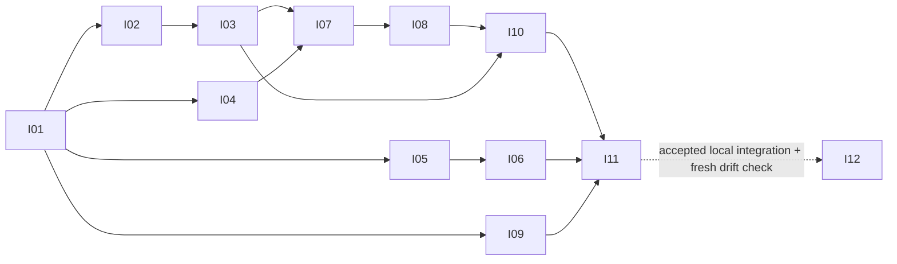
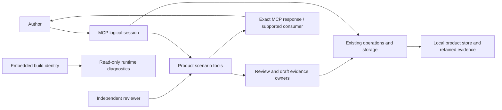

# Workflow reliability implementation plan

Status: Complete for the approved scope; I01-I12 and Q16 accepted; Q14 cancelled / no longer required, never passed
Date: 2026-10-19
Depth: Deep
Profiles: core, backend, data, operations

## Pinned approved inputs

- Project: this repository; specification slug `workflow-reliability-remediation`.
- source_version: `d6499cf2486dbf002516f0977d1f9f951a9bce97eadc44e553f99d035561aae4`
- specification_version: `b070eb5dd558d766ddfa61945c90e53d9b586a07d90a4ee8795d21b68b61fa28`
- review_ref: `e5bb7cd9-cd51-42a3-bb29-0ff4acc5b383`

Current acceptance inputs were rebound on 2026-10-19 after the explicit user
decision to exclude Headroom. Q14 is CANCELLED / NO LONGER REQUIRED, never passed.
No service ownership, registered external-connection identity, automatic-path capture
or external test remains a delivery obligation. Generic MCP integrity (WR-012/Q13),
safe recovery, response limits and all four actual native combinations remain required.
Historical execution/review evidence retains its original source, specification and
review pins; rebinding does not relabel old tests as newly executed. The prior current
pins were source `80aaa57b348e0c17731b6f9f23f9d92cd0826a3d1fe0ada37a9806e1edd30767`,
specification `113ef10ec396f650c5d6f66d93e7dedc131faf1c1512717f54ec5da756a63dfd` and
review `8090f5b2-5a46-4511-9774-32295157cf1f`.

The amended specification passed an independent 33-item review and a fresh whole-document
consistency check. Planning consumes this exact version. Before execution and
handoff call `specification_check_state` with the pinned source_version; read
only the packet's requirement IDs through `requirement_get` with the pinned
specification_version and every continuation. Workflow YAML and review archives
are read only through scenario MCP, never shell parsers.

The source baseline is a dirty working tree based on HEAD `78573edd13a1ff2a749eb66eb8a3adaf0e3a9c82`.
HEAD alone does not contain the inspected work. Existing modifications include
Technical Design fixes, review/storage changes and new untracked review-block
files and tests. Each packet must capture current tracked, staged and untracked
scope and reverify evidence before editing; no clean tree or new commit is a
prerequisite. Preserve unrelated changes.

## Current completion — 2026-10-19

All authorized implementation packets are complete. N6 and I12-R1 were accepted
after independent code and security reviews of the exact combined snapshot and
fresh reader answers. Root verified the author freeze's 325 bindings and both
review freezes. The accepted local results retain their original input domains.

The user explicitly authorized one commit, normal push and four automatic native
jobs. Commit `ba1e3afdc019e9ee2251387d1bac884024985cb3`, tree
`e6bd69a668605d393771cceee1313a4d391c4647`, was pushed to
`feature/workflow-reliability-qualification`. Its seven changed paths match the
approved candidate. [Run39231775734](https://github.com/swimmwatch/engineer-agent-workflows/actions/runs/39231775734)
completed successfully on all macOS15/Windows2025 × Node22.20.0/24.14.0
combinations. Each job passed80/80 acceptance tests with zero failed, cancelled or
skipped tests and passed the native CLI. Q16/full I11 are accepted for this exact
published tree; these results do not qualify unrelated main-worktree changes.
Model trials were explicitly skipped by this native command; accepted I09 evidence
remains historical and is not relabelled as freshly executed.

Headroom remains external and excluded from repository dependencies and acceptance.
Q14 is cancelled / no longer required, never passed. Generic exact MCP integrity,
safe recovery, response limits and the reviewed regression checks remain intact.
Historical Windows22 failures retain their original failed results. Their inner
cause remains unknown; this successful run does not prove a historical cause fix.

The [verified terminal results](../../../../artifacts/workflow-reliability-remediation/combined-v2-delivery/verified-results.json)
and [root acceptance](../../../../artifacts/workflow-reliability-remediation/coordinator/combined-v2-final-disposition.json)
bind the delivered snapshot. The [current handoff](handoff.md) owns final execution
status. No implementation packet or required acceptance check remains pending.
No further commit, push, rerun, release, merge, installation or global action is
implied by this completion. Earlier plans and reports below retain their history.

## Historical I11-N5 plan (superseded by current scope/handoff)

N4 commit `9ef2000639606f31e5c6a89b1064ce7817a4ae65`/tree `de2271456ac7491b19a3e3f103dce75d3a989181` passed three actual native combinations in run39133271930; Windows2025/Node22.20.0 failed one packed cleanup hook (76/77), native CLI skipped. This supersedes all older native/current-owner statements below. The cause is unknown; the proven defect is loss of safe nested failure identity in the TAP summary. [I11-N5](11_integration-qualification.md#current-local-correction--i11-n5-2026-10-18) owns the narrow diagnostic-only correction under WR-013/WR-014, C11/Q16. No product behavior, lifecycle, retry or budget change is planned.

The existing fixture scope owns LIFO/all-attempt disposal and exact AggregateError preservation; actor/temporary-root/packed-root owners provide optional finite labels and actual error-boundary categories; the existing test-only diagnostic channel projects bounded safe enums. No new production owner, API, dependency or framework. Preserve native `after(callback)` consumers and PID-observation error precedence. The packet defines explicit source allowlist, boundary/error table, behavioral RED/GREEN/PROVE, both pinned Linux checks, early static/lint gate and immutable long-run evidence. Six N4 planning hashes map to archived preimages in `artifacts/workflow-reliability-remediation/windows-cleanup-diagnostics-planning/planning-provenance.json`; old source/evidence freezes remain untouched.

Local implementation and separate code/security reviews are the next authorized cycle after root accepts the planning freeze. Commit/push/new four-job delivery needs fresh exact-snapshot authority; actual four native results remain required, and no Linux result clears Q16. No new durable documentation packet is warranted for this localized diagnostic fixture change. Q14 loaded identity/causal automatic-path capture is separately open; owner/supported-capture clarification is pending and no new service request is allowed. Root owns N5 invocation/reviews and any later concrete publication request; Q14 operational owner is unknown.

## Delivery and dependencies

Use MCP first. Add narrow session scenarios around existing product handlers;
do not introduce a separate CLI, client package, installer or skill orchestrator.
Existing commands remain available for build/test/isolated runtime startup.
The client machinery never chooses user answers, architecture or review verdicts.

| Packet | Independently verified outcome | Dependencies | Requirements | Quality scenarios |
| --- | --- | --- | --- | --- |
| [I01](01_regression-proof.md) | Prove the two existing Technical Design fixes | None | WR-002, WR-003, WR-013 | Q01, Q02 |
| [I02](02_actionable-diagnostics.md) | Publish actionable product-scenario diagnostics | I01 | WR-006, WR-013, WR-014 | Q03 |
| [I03](03_draft-evidence-reader.md) | Read exact draft evidence through MCP | I02 | WR-005, WR-008, WR-013, WR-014 | Q04 |
| [I04](04_runtime-identity.md) | Report the serving MCP build and capabilities | I01 | WR-009, WR-013, WR-014 | Q05 |
| [I05](05_explicit-review-hashes.md) | Separate source and verdict digest representations | I01 | WR-010, WR-013, WR-014 | Q06 |
| [I06](06_review-after-pass.md) | Recheck changed product evidence after a successful review | I01, I05 | WR-004, WR-010, WR-013, WR-014 | Q07, Q08 |
| [I07](07_mcp-session-context.md) | Provide MCP-first sessions and exact read delivery | I03, I04 | WR-007, WR-008, WR-013, WR-014 | Q09, Q10 |
| [I08](08_session-recovery.md) | Recover session operations without duplicate effects | I07 | WR-007, WR-008, WR-013, WR-014 | Q11 |
| [I09](09_architecture-checkpoint.md) | Make architecture readiness explicit in generated skills | I01 | WR-011, WR-013, WR-014 | Q12 |
| [I10](10_lossless-boundary.md) | Guard exact MCP payloads; retained acceptance | I03, I07, I08 | WR-012, WR-008, WR-013, WR-014 | Q13; Q14 cancelled |
| [I11](11_integration-qualification.md) | Qualify the integrated public and packaged workflow | I01, I02, I03, I04, I05, I06, I07, I08, I09, I10 | WR-001, WR-002, WR-003, WR-004, WR-005, WR-006, WR-007, WR-008, WR-009, WR-010, WR-011, WR-012, WR-013, WR-014 | Q15, Q16 |
| [I12](12_developer-documentation.md) | Retain original docs acceptance; execute bounded I12-R1 | N6 final independent acceptance and current I12-R1 audit-pinned input/runtime contract | WR-001, WR-004, WR-005, WR-006, WR-007, WR-008, WR-009, WR-010, WR-011, WR-012, WR-013, WR-014 | Q17 |

I01-I09 retain their accepted results. I10 repository Q13 acceptance is retained;
the former external Q14 dependency is cancelled. I11 remains subject to Q15/Q16
and no partial or old native result substitutes for the final exact snapshot.
I12 original documentation acceptance is historical and I12-R1 follows accepted
N6 final reviews and its repaired exact prepared-input/runtime contract. Its local completion does not qualify
the changed publication tree. The existing authorized execution workflow requires
separate final code/security reviews before progression.

## Historical delivery and dependency observations

The [current local I11 revalidation](../../../../artifacts/workflow-reliability-remediation/i11-current-local-revalidation/report.md)
resolves the actual-tree provenance question: a fresh Node24.14.0 build matches all
86 retained package members (83 runtime members plus three package inputs), and the
two differing-domain test files pass20/20. This is current local evidence, not a
rerun of the historical887 suite. I12/Q17 is complete with its independent reader, code and security reviews. Its
README/docs output preimages and historical reports remain preserved; the current
Linux-only wording correction receives separate review. Runtime inputs remain
guarded separately.

The later explicit instruction restores the four macOS 15 / Windows 2025 by
Node.js 22.20.0 / 24.14.0 combinations. The exact reviewed112-difference snapshot
was committed as `97b8513a4ea02b690e92bb0aaf90dfab75971865` and pushed to
`feature/workflow-reliability-qualification`. Run38942838354 actually failed all
four jobs:8 passed / 53 failed / 0 skipped in each acceptance step; downstream
native qualification was skipped. Build, generation and lint passed. The earlier
Linux-only scope/cancellation records remain historical and are superseded only
within the later bounded authorization. The one commit/push/four-job grant is
consumed; no further public action is authorized. I11-N1 permits a reversible
local fixture/packed-launch correction in a separate exact97 clone, followed by
independent reviews. It does not weaken production path guards or close Q16.

## Architectural ownership

All units below are TypeScript modules/functions or canonical Markdown templates;
there is no new class hierarchy. The portable API/field decisions are authoritative
in [contracts/mcp.md](../contracts/mcp.md). Only implementation ownership is
summarized here.

| Unit and status | Purpose, inputs and outputs | State, errors and invariants | Dependency direction / verification |
| --- | --- | --- | --- |
| Existing `product/technical.ts`: validateSemanticValue, requireReadyPrd | Semantic target and PRD pins to validated Technical Design write | Preserve exact provenance and global/stage exclusivity; failure has no effect | Existing schema/storage helpers; I01 / C01 |
| Existing `diagnostics.ts`, `product/tools.ts`, `metadata.ts` | Published schema + safe validation issues to bounded actionable errors/examples | No input echo or auto-correction; current subject list stays candidate-owned | Tool boundary calls shared normalizer, never duplicate validation in callers; I02 / C02 |
| Existing `product/interview.ts`, new draft read operation | Candidate + exact record identity/revision to full canonical portions | Candidate membership/history, immutable digest, bound cursor; read-only | Existing storage and portion mechanics, generation reader behavior retained; I03 / C03 |
| Proposed `runtime-info.ts` plus existing bootstrap/build | Loaded embedded stamp and registry to read-only version/capability diagnostics | Freeze serving identity; unavailable/mixed metadata is explicit | Build owns identity; server only exposes it; I04 / C04 |
| Existing `product/review.ts` and `review-blocks.ts` | Current/parent inventories and reviewer-authored verdicts to evidence and readiness | Exact source versus verdict digests; eligible inheritance; fresh consistency | Review uses immutable storage/operations and block membership, not sessions; I05/I06 / C05-C06 |
| Proposed `product/sessions.ts` | Opaque session ref + explicitly selected scenario to sequential context/result or bounded next portion | One in-flight checkpoint, separate actor sessions, versioned atomic updates, no fabricated answers | Session calls validated product handlers; handlers do not depend on sessions; I07/I08 / C07-C08 |
| Existing `product/operations.ts` and storage primitives | Exact request/effect evidence to safe replay or blocked recovery | Existing locks/identity/effect checks remain authoritative | Sessions reuse this owner, never introduce a transaction engine; I08 / C08 |
| Canonical Technical Design skill + generator | Confirmed profile/evidence to visible architecture before review | One template, host-specific output, actual choices, justified N/A | Templates depend on shared workflow; generated copies are never edited; I09 / C09 |
| Existing stdio/qualification harness and exact MCP boundary | Exact corpus through public/packed/response continuations to measured pass/failure | Owning identity, complete coverage, no dependent effect before verification; Q14 external work excluded | Tests adapt transport, never production semantics; I10/I11 / C10-C11 |

The reviewer uses a separate actor/session and supplies semantic judgments.
A returned receipt is delivery evidence, never proof of human consent or semantic
truth. External compression remains outside MCP ownership and is not a required repository dependency.

## Verified code map

Reverify these passages before implementing; line numbers are navigation, not pins.

- `packages/engineer-agent-workflow-mcp/src/product/technical.ts:465` and `:516`: existing applicability and PRD-pin fixes.
- `packages/engineer-agent-workflow-mcp/test/product-technical.test.mjs:316` and `:487`: current regressions.
- `packages/engineer-agent-workflow-mcp/src/product/tools.ts:140`: generic product input error boundary.
- `packages/engineer-agent-workflow-mcp/src/diagnostics.ts:76`: existing safe diagnostic mapping.
- `packages/engineer-agent-workflow-mcp/src/product/interview.ts:338` and `:1230`: draft ownership and research persistence.
- `packages/engineer-agent-workflow-mcp/src/product/context.ts:719`: generation-based decision reader.
- `packages/engineer-agent-workflow-mcp/src/server.ts:61` and `:96`: response budget and generic development identity.
- `packages/engineer-agent-workflow-mcp/src/product/bindings.ts:843`: current product capabilities.
- `packages/engineer-agent-workflow-mcp/src/product/review.ts:1581`, `:1606`, `:1885`, `:1906`: review lifecycle and hash projection.
- `packages/engineer-agent-workflow-mcp/src/product/review-blocks.ts:21`: semantic block inventory.
- `packages/engineer-agent-workflow-mcp/src/product/operations.ts:1042`, `:1062`, `:1193`: exact replay, inspection and guarded recovery.
- `packages/engineer-agent-workflow-mcp/test/support/product-e2e-harness.mjs:93`: actor context handling.
- `skills/technical-design/SKILL.md:18` and `references/technology-decisions.md` in that skill: existing pre-review obligations.
- `.github/workflows/lifecycle.yml:38`: existing product platform matrix.

## Test discipline and completion

Every packet writes its discriminating test/check first, observes relevant RED,
implements the smallest scoped behavior, reaches GREEN and runs required PROVE.
I01 starts from already-fixed behavior and therefore must prove each original
regression in an isolated dirty-source snapshot. PROVE also applies to changed
absence/structure guarantees and a RED that never reached its assertion. Record
the actual broken guarantee, failing assertion and restored state. Do not mutate
the user's live dirty files for a proof experiment.

Use public stdio/provider-consumer checks for interface contracts and owning-layer
checks for logic. Verify actual bytes, effects, source identities and full
continuations; counts or generated metadata alone do not prove correctness.
The final integrated suite includes existing full/followup compatibility,
packed artifacts and generated host outputs. Do not repeat successful checks
unless new changes or unresolved evidence require it.

The sole execution checklist is [todo.md](todo.md); [handoff.md](handoff.md) is
current state only. Each packet stops after its own checked result and handoff.
A failure stays incomplete with next action and established owner. Separate
code/security review and commits are optional explicitly invoked work, not gates.

## Platforms and external gates

| Surface/environment | Planned evidence | Current evidence |
| --- | --- | --- |
| Ubuntu / Node 24.14.0 and 22.20.0 | Public stdio, packed artifact, recovery and repository checks | Retained I11 full 887/887 and focused 109/109 results; reuse requires exact-input preflight, not a current whole-tree claim |
| macOS15 and Windows2025 / Node 22.20.0 and 24.14.0 | All four actual native results required for the exact claimed snapshot, Q16 | Published N5 commit7aa9/run39221641935: three native passes, Windows22 Q36 child/parent failure78/80 and CLI skipped; cause/timeout unknown; root/n6 read-only diagnosis. Changed I12-R1 docs/test inputs require their own exact-snapshot qualification; older passes do not qualify them. |
| Generated Codex and Claude Code skills | Generation/metadata/size/portability checks, Q12 | Accepted I09 generated-host evidence; I12 rechecks its source bindings; fixture answers remain simulation |
| Actual Codex and Claude Code execution | Separate real host/model observations | Local fixture/model-trial skips do not establish actual-host passes |
| External Headroom/host transport | Q14 CANCELLED / NO LONGER REQUIRED by explicit user scope amendment | Historical observations retained; no pass, service owner, capture, retry or external acceptance is required |

No design outputs are declared; no Penpot/design-planning stage is required.
No new data engine or storage migration is needed. Auth/security are preserved
at existing local process/path/locking boundaries; no new network surface or
auth system is introduced. CLI accessibility is not applicable to this MCP-first
delivery; any later necessary command still needs script-safe streams/cancellation.
No latency SLO is invented: the measurable target is correct bounded behavior
and reduced fresh block judgments for Q07, not an unsupported token/cost promise.

MANUAL GATE: publication/native execution is separate from local planning and
implementation. Root requests fresh authority only for a concrete frozen reviewed
snapshot. Preserve the strict exact-input verifier and all four actual native
requirements; no new public action, service call, installation or configuration
change is granted here. Historical Headroom budgets are not an active work item.

## Compatibility, rollout and recovery

Use opt-in new endpoints/modes and explicit output representation; preserve legacy
defaults and aliases. Capability checks prevent new callers from guessing support
on an old installed server. Retain immutable old evidence; reads never migrate it.
Sessions add bounded opt-in checkpoints under existing ownership and keep product
semantics unchanged. New runtime binaries can be tested side by side in isolated
stores. No global rollout or publication is included.

On a failed check, revert only the packet's scoped change or stop with its evidence;
never reset unrelated work. On unknown mutation outcome, preserve the checkpoint
and operation reference; never retry edited input, delete a lock or report success.
An old runtime that cannot interpret new optional state remains explicit about
incompatibility. Do not rewrite records to force downgrade.

## Durable documentation decision

A separate final packet is warranted: digest/replay rules are expensive to
rediscover, operators can confuse a local build with the serving process, and
new session vocabulary spans author/transport/runtime boundaries. I12 extends
the existing authoritative docs after integrated verification and tests examples
with a fresh reader. No speculative documentation tree is added.

## Planning validation and execution boundary

Planning must validate the saved YAML with the installed YAML parser, verify its
scenario schema/requirement/packet links, check every packet's dependencies and
local links, and recheck the pinned Approved specification. These checks validate
the plan, not the future feature. The scenario file retains its original planning
`not_run` baseline; actual execution evidence lives in the packets and handoff.
Historical tests are reusable only for their exact verified inputs and environment.

The user authorized the full execution cycle on 2026-10-11. The run-specific
[execution workflow](execution-workflow.md) governs automatic packet transitions
and mandatory independent code/security reviews for this run.

Next action and owner: root accepts the N6 planning freeze, invokes its diagnostic-only implementation and independent final reviews, executes the repaired I12-R1 input contract after N6 acceptance, then composes a single final reviewed snapshot. Fresh concrete publication/four-native-job authority remains required. Q14 is cancelled, not passed.
